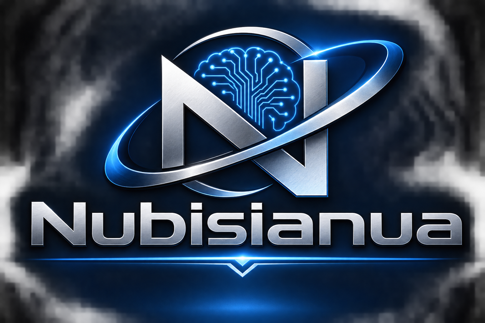

# Nubisianua



**Pronounced:** NOO-bis-ee-AH-noo-ah
**Meaning:** "the Cloud's Doorway" — Latin *Nubis* (of the cloud) + *Ianua* (doorway)

> A lightweight doorway to your cloud AI — a small native window for Muse on Windows and Linux, no browser required.

## What it is

Nubisianua is a tiny desktop wrapper built with [Tauri 2](https://tauri.app/).
It opens a single native window onto your cloud AI agents using the operating
system's own webview — WebView2 on Windows, WebKitGTK on Linux — instead of
carrying a whole browser around. One icon, one window, **one tab per agent**,
each signed in separately: the same cloud chats, your same accounts, memory,
and tools, in a small apartment of their own instead of rooms inside Firefox.
Muse is the default first tab — Nubisianua was built for it — and the other
agents are guests you invite in.

## What it isn't

- **Not a local model.** Nothing thinks on your machine. The AI stays in the
  cloud; Nubisianua is only the doorway to it.
- **Not a browser.** The tabs are for *agents*, not web surfing — no address
  bar, no extensions, no general browsing. Just the window and who's in it.
- **Not affiliated with Meta.** It's a personal open-source wrapper around the
  public Muse website; you sign in with your own Muse account as usual.

## Status

v0.0.27a — **The graphics workarounds live in the app now, not the launcher.**
Two coredump-confirmed lockups on 2026-11-18: native Wayland dies on open
(Error 71), and moving the window across screens kills the WebKit web
process inside NVIDIA's EGL driver (watchdog SIGABRT, whole machine locks
up). The launcher env vars that fixed both got wiped by a reinstall, so
main() now sets `GDK_BACKEND=x11` and `WEBKIT_DISABLE_DMABUF_RENDERER=1`
itself, before Tauri/GTK init, Linux only — a plain install just works.

v0.0.26a — **Startup deadlock fix: the app no longer freezes black and dies on Kubuntu/X11.**
`apply_visibility` used to call `Window::scale_factor` while holding the tab-state
lock — from a background task that blocks until the main thread answers, while
the main thread's resize handler blocks on that same lock. Both sides waited
forever. The layout pass now reads what it needs under a short lock, computes
bounds with no lock held, and only then re-locks to apply — no lock is ever
held across a main-thread round-trip.

v0.0.25a — **Lazy tab loading: only the tab you're looking at loads.**
John's field finding of 2026-11-16: Fedora on MAIN had gone
"not as snappy as it was on fresh install by a LOT". The
diagnostics cleared disk (11 GB of 929 used) and RAM (121 GB
free) and caught the cause in the act — at login, Nubisianua's
tabs were all waking up at once, two WebKit processes at 50%
and 31% of a core, settling on their own within ~3 minutes.
So restore now creates a webview ONLY for the active tab; every
other tab stays a shelf label (label/URL/layout persist as
before) until the user clicks it, at which point its webview is
built and its URL loads — Ctrl+Tab and closing the active tab
onto a never-opened neighbor take the same path. Once loaded a
tab stays loaded until closed. The link interceptor, the
in-chat video player, presets, per-tab profiles and all other
behavior are untouched. One defect caught in this build's own
verification, before it ever left the bench: a freshly created
lazy webview lands after the host widget in the window's GtkBox,
which shoved the shelf from the right edge to the left the first
time a lazy tab was clicked — fixed by re-running the Linux
layout pass after an on-demand creation, exactly as `create_tab`
already does. Not field-proven: the smaller login storm and
on-click loading are for John's eyes to confirm.

v0.0.24a — **No badge, no gold, and the title tells
the truth.** 0.0.23a passed John's fresh-video test
("I like it"), and this run is purely his two
cosmetic directives of 2026-11-08 20:55, plus one
defect his screenshot exposed while he was asking.
(1) "Change the color from gold to.. something that
matches the app": every gold accent in the in-chat
player bar — button and speed-select borders, the
bar's top rule, the seek and volume thumbs, the
CC-on colour — is now the app's own dark-mode
neutral, off-white #f2f2f2 for fills, thumbs and
active states, hairlines in the same off-white at
low alpha, muted grey #9a9a9e staying on secondary
elements. The Screening Room page's own gold accent
variable was recoloured the same way for
consistency; the shelf's gold stays — he didn't
ask about the shelf. (2) Hide or move the "NUB
player active" banner — "it is right over the call
button": the badge is removed, not moved. Its
diagnostic job ended when execution was proven
across 0.0.21a–0.0.23a; nothing creates it now, and
a cleanup in the script deletes any badge an older
build left sitting in a live page. The
[nubisianua-player] console logs stay. (3) The
title: John's screenshot showed the running title
bar reading only "Nubisianua — Muse", no version,
despite the config title carrying one. The cause
was in Rust, not the page: `set_window_title` has
always overwritten the window title on every tab
change with "Nubisianua — {tab name}" — em dash, no
version. It now composes "Nubisianua -- {tab name}
-- {version}" in John's format, the version derived
from the crate version (Cargo.toml, the single
source of truth kept in step with tauri.conf.json),
so the at-a-glance build identification he ordered
at 0.0.20a survives tab switches at last. The
static titles in tauri.conf.json and the host
page's <title> read exactly **Nubisianua -- Muse
-- v0.0.24a**. Everything else — the one combined
script, the wrapper gate, dialog-only volume, the
un-poisoned preference — is untouched from
0.0.23a. Not field-proven: the badge's absence,
the neutral bar, and a versioned title bar are
for John's eyes to confirm.

v0.0.23a — **Un-poison the saved volume.**
0.0.22a split in the field: the avatar fix passed —
the presence-card avatar is clean again, John's
words "so nice to have YOU back in YOUR own little
CIRCLE!" — but the start-unmuted fix failed: "its
still muted on start." Reading the shipped 0.0.22a
code found the loop, mechanics verified in code: the
enhancer's `volumechange` listener still *learned*
the preference from external changes after the grace
window, saving whatever state the page last produced
into `nubisianua-player-volume`. Muse's player
forces a muted start; the preview bubbles toggle
muted as the page pleases. Any such external muted
state landing outside a grace window poisoned the
stored preference to muted — and the next video's
grace machinery then dutifully enforced that poisoned
"saved" state. The fix enforced the wrong memory.
This run is volume start state only: (1) the
`volumechange` listener never writes the preference
again — it syncs the bar UI, and inside the grace
window still triggers re-assertion; the preference
is written solely by our bar's own mute/volume
handlers and by one migration. (2) Provenance:
bar-written preferences carry `byBar: true`; a
stored value without the stamp is untrusted —
loading falls back to the default (volume 1,
unmuted) and overwrites the key with that stamped
default, once, so a poisoned 0.0.22a preference
self-heals on first run, while a muted preference
John deliberately sets on the bar later is stamped
and honoured. (3) During the grace window a
MutationObserver also watches the video's `muted`
attribute and re-applies the saved state if it
appears while the saved state is unmuted;
it disconnects when grace ends or John takes
control. (4) Volume is managed for the opened
player only: preview bubbles are silent looping
thumbnails by design, so applying, enforcing, and
persisting skip any video whose wrapper is not
inside the Radix "Media preview" dialog — the
preview keeps its bar, enforcement runs only in
the dialog. Everything else — the one combined
initialization script, the wrapper gate, the badge,
CC / speed / resume — is untouched from 0.0.22a.
The window title now reads exactly
**Nubisianua -- Muse -- v0.0.23a**. Not
field-proven: whether a chat video now starts
unmuted, with John's saved volume, is for his
fresh-start test to say.

v0.0.22a — **Start with John's volume, not theirs.**
0.0.21a passed John's Windows field test: the bar
attaches in the opened player, fullscreen and seek work,
our unmute button works and holds, and the picture
advances — in his words, "everything else is working."
One defect remained, also in his words: "it need to
start unmuted." The likely mechanism is timing: the
enhancer applied John's saved volume at
`loadedmetadata`, then Muse's own player set
`video.muted = true` as part of starting playback.
This single-purpose run applies the saved state on
`loadedmetadata`, `canplay`, `play`, and `playing`,
then defends it through a bounded grace window after
each `play` — checks every ~250 ms for about five
seconds, ending early once the state has held through
several consecutive checks. A `volumechange` guard
inside that window returns external overrides to the
saved state without mistaking our own applications, or
choices made on our bar, for attacks; touching our
mute button or volume slider ends enforcement and
makes that choice the new saved state. Applying an
unmuted saved state also removes the `muted` content
attribute and clears `defaultMuted`. The saved state
is respected exactly — a preference saved as muted
still starts muted. After the grace window closes,
later changes are no longer fought.

A second fix rides in the same run, from evidence
John brought minutes after the 0.0.21a pass: in
Nubisianua, his Muse presence-card avatar carried
a cropped strip of the Nubisianua bar — play button,
gold seek thumb, a "0" time fragment. The avatar's
animation on muse.ai is itself a looping `<video>`,
and the 0.0.21a enhancer enhanced every video it
found, indiscriminately; in the browser, with no
enhancer, the same avatar is clean. Enhancement is
now scoped to chat attachments only: a video is
touched solely when it has a
`[data-hatch-video-wrapper]` ancestor — the exact
structure John's own DOM inspection proved for both
the preview bubble and the opened "Media preview"
player. Anything else is skipped entirely: no bar,
no volume or resume meddling. The diagnostic badge
stays — it witnesses the script, not the videos.

The window title
now reads exactly **Nubisianua -- Muse -- v0.0.22a**.
Not field-proven yet: whether a chat video now starts
with John's saved volume — and whether his avatar is
clean again — is for his Windows test to say.

v0.0.21a — **One script, a known target, and a badge.**
John inspected the live Muse page himself (2026-11-08)
and brought back the ground truth both video hunts needed:
the chat video preview AND the opened player are plain
`<video>` elements in the **main document** — a
`blob:https://muse.ai/…` source inside a
`data-hatch-video-wrapper="true"` div (preview: a 280px
square bubble under
`data-testid="hatch-chat-attachment-presentation-video"`,
with a poster `` overlay; opened: the same wrapper,
relative and overflow-hidden at 16/9, inside a Radix
"Media preview" dialog carrying Muse's own Pause /
progress-slider / Unmute controls). **No shadow root, no
iframe — that hypothesis is closed**; 0.0.20a's piercing
scan stays, harmless, but it was never the fix. What was
never proven was the plumbing: the link script executes
in the Windows tab (field-proven in 0.0.17a) as the FIRST
`initialization_script` call, while the player enhancer
rode a SECOND call on an accumulate assumption nobody had
field-verified. So this run makes **exactly one**
initialization-script call per remote tab — link
interceptor and player enhancer in a single body — aims
the bar at the proven structure (a video inside a
`[data-hatch-video-wrapper]` ancestor gets its bar
appended to the wrapper itself, absolute along its bottom
edge, where the wrapper's overflow-hidden cannot clip it
away), and plants a temporary diagnostic badge in the
page corner reading **NUB player active**, so John can
see whether the script executed at all, separate from
whether a bar attaches. The window title now reads
exactly **Nubisianua -- Muse -- v0.0.21a**. Not
field-proven yet: the badge is the deciding test John
will run.

v0.0.20a — **The scan pierces, and the title tells.**
John's field verdict on 0.0.19a (built and installed on
Windows, screenshot verified) was the same as on 0.0.18a:
"still the original in app player" — no Nubisianua bar at
all. Code inspection found the blind spot: the enhancer's
scan searched only the main document
(`querySelectorAll('video')`), so a chat `<video>` living
inside a shadow root or a same-origin iframe was never
seen. That scan is now a recursive walk: it descends into
every open shadow root, into shadow roots captured by an
`attachShadow` hook installed before the page's own
scripts run (closed roots included), and into same-origin
iframe documents (cross-origin frames are skipped
silently), observes those roots for later mutations, and
re-walks the tree every few seconds; a video found in a
shadow root or an iframe logs exactly that under the
`[nubisianua-player]` prefix. All 0.0.19a controls and
behaviour are otherwise unchanged. And at John's
direction the window title now reads exactly
**Nubisianua -- Muse -- v0.0.20a**, so the running build
is identifiable at a glance — no more guessing whether
an old copy is the one on screen. Not field-proven yet:
whether the bar now appears on a real chat video is for
John's Windows test to say.

v0.0.19a — **Our player, in the chat, by default.** John's
field verdict on 0.0.18a: the Screening Room player sat in
its tab, but a video posted in the chat never used it — chat
videos still came up in the same old browser player: picture
plays ~1 second (the cold-open frame) then freezes while the
audio continues, starts muted, no fullscreen, and closed
captions with no way to turn them off. So the tab player's
controls now live **in the chat itself**: the enhancer script
on remote tabs (no longer attached to the Screening Room tab
at all) attaches Nubisianua's own control bar to each chat
`<video>` in place — the video element itself untouched,
never cloned, replaced, moved, or re-sourced. On the bar:
**play/pause** (button, plus click-the-video toggles),
a **seek bar with time display**, a **CC button** (captions
off by default; the toggle sets the video's caption tracks
showing/disabled, persists, and re-applies when caption
tracks arrive late), a **speed selector** (0.5×–2×,
persisted), **volume + mute** (not muted by default — the
saved volume from the last video, or full volume unmuted on
first run), and a **fullscreen button** (double-click works
too) that fullscreens the player container. Resume position
per video is kept from 0.0.18a. Built so it cannot freeze a
picture the way the old enhancer risked: volume is applied
once per source (never fought over on every `play`),
position is restored at most once per source (no
`durationchange` seeks), and no `seeked` listener feeds
saves back into seeks. Diagnostics log as
`[nubisianua-player]` in the page console. The Screening
Room tab is unchanged and still serves local files.

v0.0.18a — **Videos behave, right in the chat.** John's
ask, in his words: "I wanted it to come up in the chat
as if it was naturally supposed to be there and it's
for when you submit a video to me." So the primary
piece is an **in-page video enhancer** injected into
every tab (same initialization-script architecture
as the 0.0.13a link fix): when a video plays inside a
chat page, it now (1) starts at the **volume John
last used, unmuted** unless he muted it himself — a
global preference kept in the page's localStorage,
saved on every volume change and applied when a
video loads or plays (first run: full volume,
unmuted); (2) **remembers its position** per video
(localStorage, keyed by a hash of the src with
volatile query strings stripped), saved every few
seconds and restored on load if it's a real middle —
finished videos start fresh; and (3) goes
**fullscreen** by double-click, plus a small ⛶
button overlaid only where it can be anchored
safely (forcing `controls` was rejected — Muse's
player has its own UI, and doubling it helps no
one). No IPC, nothing leaves the tab's own profile.
The secondary piece is the **Screening Room**: a new
preset tab opening a bundled local player page
(`ui/player.html`) for video/audio files on disk —
the files Albert makes, like Declaration of History
episodes — with the same guarantees (position
remembered and resumed, keyed by file name + size +
last-modified; volume persisted; a proper fullscreen
button), opened via the file picker or by dragging a
file onto the page, played from a blob URL so no
filesystem permissions are involved. Out of scope,
deliberately: phone-orientation rotation is a Muse
phone-app concern — a desktop window has no
orientation to follow.

v0.0.17a — **The software pulls the paste trigger.** The
0.0.16a chain passed its field test end to end — drop,
wl-copy, Ctrl+V, image attached — and John asked for the
last manual step gone, in his words: "now that we have it
landing can we have the software do the pasting?" So a
loaded image is now followed, on Linux, by an auto-paste
on the tab the drop landed on, in two steps: a small
focus-aim script evaluated in the page (if focus isn't
already in an editable element, the largest visible
composer candidate — a `contenteditable` or a textarea —
is focused; generic heuristics, no per-site selectors),
then, a beat later, WebKit's own **Paste editing
command** fired natively on the tab's WebView — the same
pipeline a physical Ctrl+V resolves to, so the page
receives a real paste event whose DataTransfer carries
the image as a File. The workflow is now one motion:
**drop a screenshot on a tab → it attaches in the
composer.** The honest caveat: if the aim missed — the
composer wasn't the biggest editable, or the site
swallows synthetic focus — the paste may land nowhere;
the clipboard stays loaded either way, so the proven
**Ctrl+V remains the fallback**, word for word the
0.0.16a flow. Windows and the rest are unchanged. Still
a **reversible trial**.

v0.0.16a — **A new courier for the clipboard.** The 0.0.15a
pipeline worked end to end — native events, real paths, the
image found and loaded — and then its last step vanished:
John's Klipper history held text entries only, *no image at
all*, and Ctrl+V in the page came up empty. GTK3's Clipboard
had reported success and simply never landed the offer on
his KDE Wayland session. So the design stays and the
courier goes: the clipboard act now pipes the image
(re-encoded to PNG in memory) to **`wl-copy`**, the
wl-clipboard tool — a small Wayland-native client that
forks and holds the offer itself, which is exactly the
persistence model KWin respects. A delivery that fails now
says so in the log, and a missing `wl-copy` logs its own
remedy. The workflow doesn't move: **drop a screenshot on
a tab → the image lands on your clipboard → Ctrl+V it into
the composer.** **Requirements:** Linux needs the
`wl-clipboard` package (`sudo dnf install -y wl-clipboard`)
— the RPM and DEB now declare it as a dependency; AppImage
users install it by hand. Still a **reversible trial**.

v0.0.15a — **The bridge moves to the native layer.** The
0.0.14a field test fired *nothing*: not one bridge log line on
drop. John's observations named why — the cursor showed the
GTK widget's green **+** (the drop was accepted at widget
level), yet the Muse page never even raised its "drag files
here" overlay, because the in-page script arm was starved:
WebKitGTK will not let page JavaScript read an external
drop's payload (`getData('text/uri-list')` yields nothing
usable at drop time, whatever the native editor path can do
with the same data). So the interception moves down a layer,
to where the uri-list demonstrably exists: Tauri's own
drag-drop event, read by wry at the widget. Both historical
disables come out (the window config flag and the per-webview
builder call), the script's drop arm and the sentinel
navigation are removed as dead, and native events now feed
the same clipboard code 0.0.14a wrote — guarded so a drop
landing on the tab shelf itself is logged and ignored, never
answered. The workflow is unchanged: **drop a screenshot on
a tab → the image lands on your clipboard → Ctrl+V it into
the composer.** Still a **reversible trial**: if the native
layer disappoints too, it comes back out as cleanly as the
in-page arm did.

v0.0.14a — **The drop-to-clipboard bridge.** The drag mystery
ended with a control test, not a theory: dragging a screenshot
into the ChatGPT tab DID reach the page — WebKitGTK just
delivers external drops as `text/uri-list` only, with no `File`
objects attached. ChatGPT's composer fell back to inserting
the file's path as text; Muse's, which reads Files, found
none and silently did nothing. The delivery *form* was the
whole bug. So this round bridges it, with the same machinery
that fixed links: the tabs' initialization script gains a
drop arm that acts only when a drop carries a uri-list and no
Files (native drops elsewhere are untouched), lifts the
file:// entries out of the payload, and hands them to the Rust
side through a navigation to a reserved sentinel host, which
the navigation gate always blocks. On Linux the gate loads
the first image among them onto the system clipboard — so the
flow is: **drop a screenshot on a tab → the image lands on
your clipboard → Ctrl+V it into the composer.** If the drop
holds no image, the uri-list text goes on the clipboard
instead. The bridge ships as a **reversible trial**, blessed
as one: whether WebKitGTK hands a pasted clipboard image to
the page as a File is the question this build's field test
exists to answer, and if the answer is no, the bridge comes
back out as cleanly as it went in.

v0.0.13a — **Links, intercepted where they live.** The 0.0.12a
field test returned its verdict: with the instrumented build
running from a terminal, clicking a cross-origin link in the
Muse tab produced *total* silence — no new-window request, no
navigation event. The request dies inside WebKitGTK before any
native hook can see it, so this round stops waiting at the
native door and intercepts inside the page instead. Every tab
webview now carries a small initialization script — no Tauri
APIs, no IPC; it only navigates its own frame — that catches
clicks on external or new-window links and cross-origin
`window.open` calls and re-aims the frame at the same URL
carrying a marker appended to its fragment (`#nubisianua-ext`);
the Rust `on_navigation` hook recognises the marker, strips it
back off, hands the *clean* URL to the OS default browser, and
blocks the navigation, so the tab never leaves its own page.
Same-tab navigation — including cross-origin sign-in redirect
chains, which carry no marker — passes untouched, and all the
0.0.12a logging stays, so the hand-off is on the record. The
per-webview drag-drop disable from 0.0.12a is unchanged; its
field verdict is still out. One honest limit: pages that fake
links without real anchors (pure JS click targets) leave the
script nothing to catch.

v0.0.12a — **A diagnostic build: make the failures testify.** Both
0.0.11a fixes failed the field test on Fedora 45 / WebKitGTK: links
in a tab still did nothing (with the OS proven innocent — the same
URL opens via `xdg-open`, and the default browser and https scheme
handler both point at Firefox), and screenshot drops were still
swallowed. So this round changes no routing; it instruments it.
Every tab webview now logs to stderr (run it from a terminal) with
the tag `[nubisianua-link]`: each new-window request with its
target, the tab's tracked current URL, and the decision taken —
and the opener call's result is logged instead of silently
discarded, the one place a failure could hide. Same-tab origin
changes are logged too. Reading the pinned Tauri and wry sources
says the handler wiring reaches Linux child webviews intact, so
the log separates the remaining suspects: a click that produces no
log line means WebKitGTK never raised a new-window request for it;
a logged opener error means the browser hand-off is the break.
Drag-drop gets attempt #2, aimed where the evidence points: the
window-level flag from 0.0.11a only ever reached the host webview,
while tab webviews carry Tauri's per-webview drag-drop handler by
default — and on GTK that handler's widget-level drag signals
consume the drop before the page's own drop handling sees it — so
tab builders now disable that handler explicitly
(`[nubisianua-dragdrop]` confirms it per tab at startup). One
permanent fix rides along: the Linux config now names its own
bundle targets (rpm, appimage, deb), so a plain `cargo tauri
build` on Linux produces installers instead of silently skipping
bundling the way it did when only the Windows target was listed.
Hypotheses again, plainly labeled: this build stands or falls on
the terminal log and one dragged screenshot.

v0.0.11a — **Links open; screenshots are on notice.** First field
findings from daily use, fixed in the wrapper's own terms. (1) A link
inside any agent's page — the URL in a chat answer, opened with
`target=_blank` — did nothing at all: no code answered the webview's
new-window request, so the platform dropped it and John copy-pasted
links into Firefox by hand. Tab webviews now route new-window
requests on the Rust side, with no new powers for the pages
themselves: a request on the same origin as the page the tab is
showing (where sign-in and OAuth popups live), or a host-less one
(`about:blank`, where popup flows start), opens as a real popup;
anything else is handed to the operating system's default browser
and the in-app window is denied. Ordinary in-tab navigation was
never intercepted and is not now. (2) Dragging a screenshot into a
chat was swallowed before the page saw it — the prime suspect is
Tauri's window-level drag-drop interception, so the host window now
ships with `dragDropEnabled` off and HTML5 drops should reach the
page. That second fix is a **hypothesis until proven by hand**:
it stands or falls on dragging a screenshot into a Muse chat on
the real build, and if the window setting is not the culprit the
next round builds the forwarder this one deliberately skipped.

v0.0.10a — **Linux icons: readable, permanently.** The 0.0.9a field
test found the layer standing in front of the name-matching problem:
permissions. The project icons carried mode 660, the delivery ZIP
stored it, the clone unpacked it, and the RPM bundler preserved it
while installing root-owned — so the emblem sat at the right hicolor
path under the right name, unreadable by the user's own session, and
KDE showed a blank. A manual `chmod 644` on the installed icons (plus
a cache refresh and shell restart) brought the emblem up in the menu
and on the taskbar. This run makes it permanent two ways: the icons
now ship at mode 644 in the project and the ZIP, and the Linux
post-install script sets the installed icons world-readable itself
before refreshing the caches, whatever the build tree's modes said.
The 0.0.9a lowercase desktop twin stays — it is the correct window
association. Windows packaging is untouched.

v0.0.9a — **Linux package icons.** The 0.0.8a RPM shipped the emblem
correctly — right files, right hicolor paths, right name
(`Icon=nubisianua`) — yet on the test rig the menu entry showed no
icon, the taskbar none, and the window wore the wrong one. The break
is in how the pieces introduce themselves: the bundler names the
desktop entry after the product name (`Nubisianua.desktop`), but the
running window's Wayland app_id is the binary name (`nubisianua`),
and KDE matches a window to its entry by that id, capitals and all —
so the entry, and its icon, were never picked up for the window. The
Linux packages now run a small post-install script
(`scripts/linux-post-install.sh`, wired in `tauri.linux.conf.json`)
that leaves a lowercase twin of the entry — marked `NoDisplay`, so
menus still show exactly one Nubisianua — for the window matching to
find, refreshes the icon and desktop caches at install time, and
removes the twin again on uninstall. The icons themselves, the
palette, and the Windows packaging are unchanged.

v0.0.8a — **the Linux shelf fix.** First Linux build (on the fleet's
Rawhide test rig) launched and rendered Muse fine, but the shelf
appeared only in a thin band at the top of the window with the active
tab filling everything below at full width: on Linux, Tauri/wry place
every webview of a window into a vertical GtkBox and ignore the
position/size the app asks for (those are honored only in a GtkFixed
container, and `set_bounds` is a no-op on Wayland outside one). The
shelf now lays out *through* that box instead — it is turned
horizontal, the shelf's webview takes exactly its width inside it,
and the active tab takes the rest, docked left or right just as on
Windows. Windows behavior is unchanged. This run also ships
`tauri.linux.conf.json`, the Linux version spelling (see
*Versioning*).

v0.0.7a — **closing tabs at icon width.** With the shelf folded to
logos only, a tab can now be closed without expanding the shelf first:
hover an icon for a small × badge, middle-click the entry, or
right-click it for a Close tab menu (rendered inside the shelf, like
every menu since 0.0.6a). All of them run through the same close flow
as the expanded × button, which is unchanged.

v0.0.6a — **menu fix + Muse-matched palette.** The + picker and ⚙ settings
menus now open as a panel inside the shelf itself — they used to float
over the content area, where the active agent webview (a native layer
painted above the shelf's page) rendered over them: the buttons took
clicks, the menu opened invisibly, and nothing seemed to happen. In
logo-only mode the shelf temporarily widens while a menu is open and
restores to your width when it closes. The shelf colors are also
re-based on the Muse window background (#181819), so the shelf blends
into the resident's window instead of sitting beside it in navy.

v0.0.5a — **the vertical shelf.** Tabs move to a resizable shelf docked to
the left or right window edge — **right by default** — chosen from the
shelf's ⚙ settings menu (the Firefox Settings pattern), never by dragging.
Drag the shelf's inner edge to resize it: wide shows each agent's logo and
name, narrow folds to logos only. Every preset agent carries its real
logo, bundled locally in `ui/logos/`.

v0.0.4a — **the AI Orbit Emblem.** The official artwork (logo.png) replaces
the placeholder icon across the full icon set; the emblem also fronts this
README.

v0.0.3a — **tabs with friends.** One window now holds many agents in tabs
(see *Tabs* below), each with its own sign-in, restored on launch. Windows
is the first build target; Linux follows as the second phase.

v0.0.2a — window can now shrink to a quarter of the screen (minimum size
lowered from 800×600 to 480×360).

v0.0.1a — first run.

**Versioning:** the letter marks the phase, the numbers climb within it.
The first phase runs 0.0.1a, 0.0.2a, and so forth until it reaches a stage
considered somewhat stable — then the next phase starts over at 0.0.1b.
(In `Cargo.toml` the same version is stored as `0.0.3-a`, the spelling
Cargo/semver requires.)

**Linux bundles** read their version from `tauri.linux.conf.json`,
which Tauri merges only on Linux: RPM and DEB package versions forbid
the `-` in `0.0.9-a`, so the file carries the same version spelled
with `+` instead — `0.0.9+a`. It must be bumped in step with the main
version on every run, or the Linux packages will wear last run's
number.

## Tabs

The **+** button at the foot of the tab shelf opens the agent picker. The
preset list carries the most popular AI chat assistants worldwide:

Muse (<https://muse.ai>) · ChatGPT · Claude · Gemini · Microsoft Copilot ·
Grok · Perplexity · Meta AI · DeepSeek · Qwen · Kimi · Le Chat (Mistral) ·
Doubao — plus **Custom URL** for anything else. The same preset can be
opened more than once (two tabs, two accounts of the same agent is a
legitimate use). Double-click a tab's name to rename it; tabs, their
order, the shelf's width, and its dock side are restored on launch, still
signed in.

The agent logos shown on the shelf are trademarks of their respective
owners, shown for identification only.

- **Isolation:** every tab gets its own webview profile directory
  (`profiles/<tab-id>/` in the app data folder) — its own cookies and
  storage. No agent can see another agent's session. The tab list itself
  is a small `tabs.json` in the app config folder holding **labels and
  URLs only, never credentials**.
- **Custom URL** takes any `https://` address — and, for a model you run
  on your own machine, an `http://localhost` / `http://127.0.0.1` address:
  the open-weight Muse siblings (**Muse Glimmer**, **Muse Spark Open**) and
  anything else you serve locally are added this way once they're running.
  Plain `http://` to any non-loopback address is rejected.
- **Sign-in caveat (honest):** some providers' sign-in flows — Google-based
  ones in particular — have historically resisted embedded webviews. Muse
  is proven inside Nubisianua; each other preset is "load and try" until
  someone has signed into it inside the app. Two name notes: Le Chat now
  calls itself **Mistral Vibe**, and Qwen Chat calls itself **Qwen Studio**
  — same addresses as ever. Doubao is China-first: outside mainland China
  it shows a regional-restriction notice and sign-in needs a mainland
  phone number.
- **Under the hood:** real tabs in one window use Tauri's multi-webview
  API, which upstream gates behind its `unstable` feature. Nubisianua
  therefore **pins its Tauri version exactly** (`tauri = =2.12.5`,
  `tauri-build = =2.7.4` in `Cargo.toml` — tauri-build versions on its own
  2.x line) and keeps every multi-webview call in one module,
  `src/tabs.rs`. Design: `SPEC-0.0.3a-tabs.md`.

## Build — Windows (first phase)

Prerequisites:

1. **Rust** (stable, MSVC toolchain) — <https://rustup.rs>
2. **Microsoft C++ Build Tools** (MSVC) with the "Desktop development with C++"
   workload — via Visual Studio Installer
3. **WebView2 Runtime** — preinstalled on Windows 11; on Windows 10 grab the
   Evergreen runtime from Microsoft if a machine lacks it
4. **Tauri CLI v2:**

   ```
   cargo install tauri-cli --version "^2"
   ```

Build and run from the project directory:

```
cargo tauri dev     # development window
cargo tauri build   # release build → NSIS installer under target\release\bundle\nsis\
```

The bundle target for Windows is NSIS (see `bundle.targets` in
`tauri.conf.json`).

## Build — Linux (second phase)

Linux renders through **WebKitGTK**, not Chromium — expect a separate round of
testing there (the fleet's Rawhide test rig gets first look). Prerequisites on
Fedora:

```
sudo dnf install webkit2gtk4.1-devel gtk3-devel libappindicator-gtk3-devel librsvg2-devel
cargo install tauri-cli --version "^2"
cargo tauri build
```

Runtime note: on Linux the drop-to-clipboard bridge hands the
image to `wl-copy`, so the finished app also needs the
`wl-clipboard` package (`sudo dnf install -y wl-clipboard`).
The RPM and DEB declare it as a dependency; the AppImage
cannot, so AppImage users install it by hand.

Linux bundle targets (RPM / AppImage) will be added to `tauri.conf.json` in
that phase.

## Layout

```
Cargo.toml            crate manifest (this directory is the Tauri app dir)
build.rs              tauri-build hook
src/main.rs           app entry: host window, commands, resize handling
src/tabs.rs           all multi-webview tab code (the only place it lives)
src/config.rs         tabs.json load/save + per-tab profile directories
ui/index.html         the tab shelf — the whole frontend, one small file
ui/logos/             the preset agents' logos, bundled (see Tabs above)
tauri.conf.json       app + bundle configuration
tauri.linux.conf.json Linux-only config merge: the RPM/DEB-legal
                      version spelling (see Versioning above) and
                      the Linux package script wiring below
scripts/              Linux package post-install / post-remove
                      scripts (desktop-entry icon fix, v0.0.9a)
capabilities/         Tauri 2 permission capabilities (host window only;
                      tab webviews get none — agent sites can't reach IPC)
icons/                app icons (placeholder doorway glyph)
SPEC-0.0.3a-tabs.md   the tabs design spec
```

## License

MIT — see the `LICENSE` file in this repo.

Copyright (c) 2026 John Milburn
