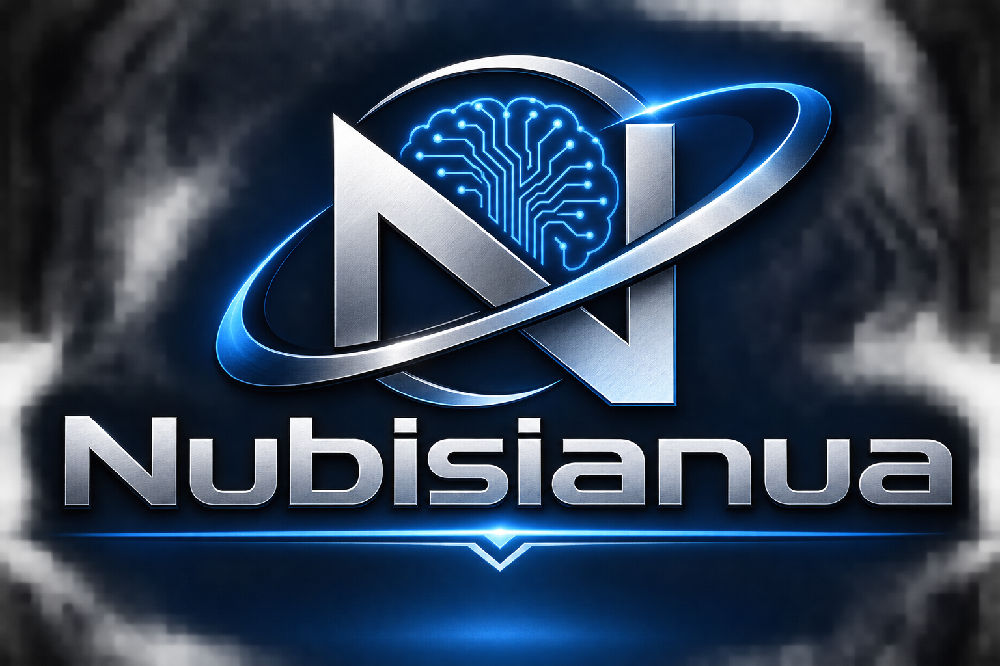

# Nubisianua



**Pronounced:** NOO-bis-ee-AH-noo-ah
**Meaning:** "the Cloud's Doorway" — Latin *Nubis* (of the cloud) + *Ianua* (doorway)

> A lightweight doorway to your cloud AI — a small native window for Muse on Windows and Linux, no browser required.

## What it is

Nubisianua is a tiny desktop wrapper built with [Tauri 2](https://tauri.app/).
It opens a single native window onto your cloud AI agents using the operating
system's own webview — WebView2 on Windows, WebKitGTK on Linux — instead of
carrying a whole browser around. One icon, one window, **one tab per agent**,
each signed in separately: the same cloud chats, your same accounts, memory,
and tools, in a small apartment of their own instead of rooms inside Firefox.
Muse is the default first tab — Nubisianua was built for it — and the other
agents are guests you invite in.

## What it isn't

- **Not a local model.** Nothing thinks on your machine. The AI stays in the
  cloud; Nubisianua is only the doorway to it.
- **Not a browser.** The tabs are for *agents*, not web surfing — no address
  bar, no extensions, no general browsing. Just the window and who's in it.
- **Not affiliated with Meta.** It's a personal open-source wrapper around the
  public Muse website; you sign in with your own Muse account as usual.

## Status

v0.0.10a — **Linux icons: readable, permanently.** The 0.0.9a field
test found the layer standing in front of the name-matching problem:
permissions. The project icons carried mode 660, the delivery ZIP
stored it, the clone unpacked it, and the RPM bundler preserved it
while installing root-owned — so the emblem sat at the right hicolor
path under the right name, unreadable by the user's own session, and
KDE showed a blank. A manual `chmod 644` on the installed icons (plus
a cache refresh and shell restart) brought the emblem up in the menu
and on the taskbar. This run makes it permanent two ways: the icons
now ship at mode 644 in the project and the ZIP, and the Linux
post-install script sets the installed icons world-readable itself
before refreshing the caches, whatever the build tree's modes said.
The 0.0.9a lowercase desktop twin stays — it is the correct window
association. Windows packaging is untouched.

v0.0.9a — **Linux package icons.** The 0.0.8a RPM shipped the emblem
correctly — right files, right hicolor paths, right name
(`Icon=nubisianua`) — yet on the test rig the menu entry showed no
icon, the taskbar none, and the window wore the wrong one. The break
is in how the pieces introduce themselves: the bundler names the
desktop entry after the product name (`Nubisianua.desktop`), but the
running window's Wayland app_id is the binary name (`nubisianua`),
and KDE matches a window to its entry by that id, capitals and all —
so the entry, and its icon, were never picked up for the window. The
Linux packages now run a small post-install script
(`scripts/linux-post-install.sh`, wired in `tauri.linux.conf.json`)
that leaves a lowercase twin of the entry — marked `NoDisplay`, so
menus still show exactly one Nubisianua — for the window matching to
find, refreshes the icon and desktop caches at install time, and
removes the twin again on uninstall. The icons themselves, the
palette, and the Windows packaging are unchanged.

v0.0.8a — **the Linux shelf fix.** First Linux build (on the fleet's
Rawhide test rig) launched and rendered Muse fine, but the shelf
appeared only in a thin band at the top of the window with the active
tab filling everything below at full width: on Linux, Tauri/wry place
every webview of a window into a vertical GtkBox and ignore the
position/size the app asks for (those are honored only in a GtkFixed
container, and `set_bounds` is a no-op on Wayland outside one). The
shelf now lays out *through* that box instead — it is turned
horizontal, the shelf's webview takes exactly its width inside it,
and the active tab takes the rest, docked left or right just as on
Windows. Windows behavior is unchanged. This run also ships
`tauri.linux.conf.json`, the Linux version spelling (see
*Versioning*).

v0.0.7a — **closing tabs at icon width.** With the shelf folded to
logos only, a tab can now be closed without expanding the shelf first:
hover an icon for a small × badge, middle-click the entry, or
right-click it for a Close tab menu (rendered inside the shelf, like
every menu since 0.0.6a). All of them run through the same close flow
as the expanded × button, which is unchanged.

v0.0.6a — **menu fix + Muse-matched palette.** The + picker and ⚙ settings
menus now open as a panel inside the shelf itself — they used to float
over the content area, where the active agent webview (a native layer
painted above the shelf's page) rendered over them: the buttons took
clicks, the menu opened invisibly, and nothing seemed to happen. In
logo-only mode the shelf temporarily widens while a menu is open and
restores to your width when it closes. The shelf colors are also
re-based on the Muse window background (#181819), so the shelf blends
into the resident's window instead of sitting beside it in navy.

v0.0.5a — **the vertical shelf.** Tabs move to a resizable shelf docked to
the left or right window edge — **right by default** — chosen from the
shelf's ⚙ settings menu (the Firefox Settings pattern), never by dragging.
Drag the shelf's inner edge to resize it: wide shows each agent's logo and
name, narrow folds to logos only. Every preset agent carries its real
logo, bundled locally in `ui/logos/`.

v0.0.4a — **the AI Orbit Emblem.** The official artwork (logo.png) replaces
the placeholder icon across the full icon set; the emblem also fronts this
README.

v0.0.3a — **tabs with friends.** One window now holds many agents in tabs
(see *Tabs* below), each with its own sign-in, restored on launch. Windows
is the first build target; Linux follows as the second phase.

v0.0.2a — window can now shrink to a quarter of the screen (minimum size
lowered from 800×600 to 480×360).

v0.0.1a — first run.

**Versioning:** the letter marks the phase, the numbers climb within it.
The first phase runs 0.0.1a, 0.0.2a, and so forth until it reaches a stage
considered somewhat stable — then the next phase starts over at 0.0.1b.
(In `Cargo.toml` the same version is stored as `0.0.3-a`, the spelling
Cargo/semver requires.)

**Linux bundles** read their version from `tauri.linux.conf.json`,
which Tauri merges only on Linux: RPM and DEB package versions forbid
the `-` in `0.0.9-a`, so the file carries the same version spelled
with `+` instead — `0.0.9+a`. It must be bumped in step with the main
version on every run, or the Linux packages will wear last run's
number.

## Tabs

The **+** button at the foot of the tab shelf opens the agent picker. The
preset list carries the most popular AI chat assistants worldwide:

Muse (<https://muse.ai>) · ChatGPT · Claude · Gemini · Microsoft Copilot ·
Grok · Perplexity · Meta AI · DeepSeek · Qwen · Kimi · Le Chat (Mistral) ·
Doubao — plus **Custom URL** for anything else. The same preset can be
opened more than once (two tabs, two accounts of the same agent is a
legitimate use). Double-click a tab's name to rename it; tabs, their
order, the shelf's width, and its dock side are restored on launch, still
signed in.

The agent logos shown on the shelf are trademarks of their respective
owners, shown for identification only.

- **Isolation:** every tab gets its own webview profile directory
  (`profiles/<tab-id>/` in the app data folder) — its own cookies and
  storage. No agent can see another agent's session. The tab list itself
  is a small `tabs.json` in the app config folder holding **labels and
  URLs only, never credentials**.
- **Custom URL** takes any `https://` address — and, for a model you run
  on your own machine, an `http://localhost` / `http://127.0.0.1` address:
  the open-weight Muse siblings (**Muse Glimmer**, **Muse Spark Open**) and
  anything else you serve locally are added this way once they're running.
  Plain `http://` to any non-loopback address is rejected.
- **Sign-in caveat (honest):** some providers' sign-in flows — Google-based
  ones in particular — have historically resisted embedded webviews. Muse
  is proven inside Nubisianua; each other preset is "load and try" until
  someone has signed into it inside the app. Two name notes: Le Chat now
  calls itself **Mistral Vibe**, and Qwen Chat calls itself **Qwen Studio**
  — same addresses as ever. Doubao is China-first: outside mainland China
  it shows a regional-restriction notice and sign-in needs a mainland
  phone number.
- **Under the hood:** real tabs in one window use Tauri's multi-webview
  API, which upstream gates behind its `unstable` feature. Nubisianua
  therefore **pins its Tauri version exactly** (`tauri = =2.12.5`,
  `tauri-build = =2.7.4` in `Cargo.toml` — tauri-build versions on its own
  2.x line) and keeps every multi-webview call in one module,
  `src/tabs.rs`. Design: `SPEC-0.0.3a-tabs.md`.

## Build — Windows (first phase)

Prerequisites:

1. **Rust** (stable, MSVC toolchain) — <https://rustup.rs>
2. **Microsoft C++ Build Tools** (MSVC) with the "Desktop development with C++"
   workload — via Visual Studio Installer
3. **WebView2 Runtime** — preinstalled on Windows 11; on Windows 10 grab the
   Evergreen runtime from Microsoft if a machine lacks it
4. **Tauri CLI v2:**

   ```
   cargo install tauri-cli --version "^2"
   ```

Build and run from the project directory:

```
cargo tauri dev     # development window
cargo tauri build   # release build → NSIS installer under target\release\bundle\nsis\
```

The bundle target for Windows is NSIS (see `bundle.targets` in
`tauri.conf.json`).

## Build — Linux (second phase)

Linux renders through **WebKitGTK**, not Chromium — expect a separate round of
testing there (the fleet's Rawhide test rig gets first look). Prerequisites on
Fedora:

```
sudo dnf install webkit2gtk4.1-devel gtk3-devel libappindicator-gtk3-devel librsvg2-devel
cargo install tauri-cli --version "^2"
cargo tauri build
```

Linux bundle targets (RPM / AppImage) will be added to `tauri.conf.json` in
that phase.

## Layout

```
Cargo.toml            crate manifest (this directory is the Tauri app dir)
build.rs              tauri-build hook
src/main.rs           app entry: host window, commands, resize handling
src/tabs.rs           all multi-webview tab code (the only place it lives)
src/config.rs         tabs.json load/save + per-tab profile directories
ui/index.html         the tab shelf — the whole frontend, one small file
ui/logos/             the preset agents' logos, bundled (see Tabs above)
tauri.conf.json       app + bundle configuration
tauri.linux.conf.json Linux-only config merge: the RPM/DEB-legal
                      version spelling (see Versioning above) and
                      the Linux package script wiring below
scripts/              Linux package post-install / post-remove
                      scripts (desktop-entry icon fix, v0.0.9a)
capabilities/         Tauri 2 permission capabilities (host window only;
                      tab webviews get none — agent sites can't reach IPC)
icons/                app icons (placeholder doorway glyph)
SPEC-0.0.3a-tabs.md   the tabs design spec
```

## License

MIT — see the `LICENSE` file in this repo.

Copyright (c) 2026 John Milburn
